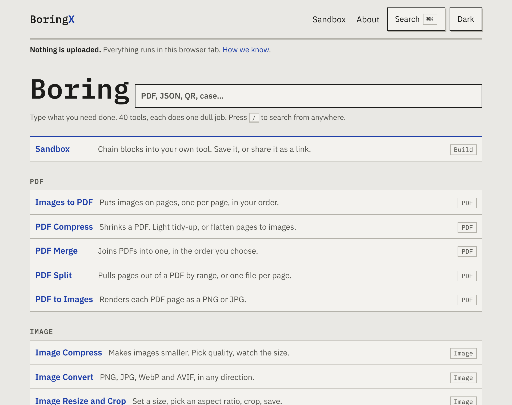
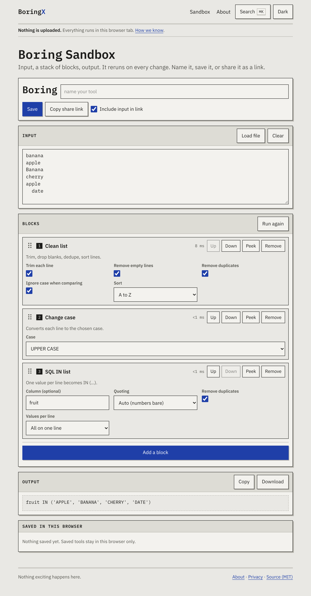
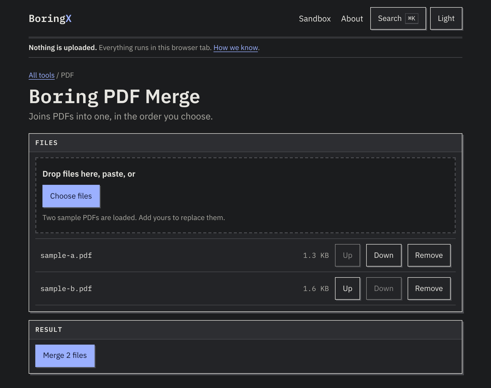

# BoringX

Small tools that each do one dull job, entirely in your browser. 40 tools, plus a Sandbox for chaining them. No uploads, no accounts, no limits, no watermarks.



| Sandbox | A tool (dark theme) |
| --- | --- |
|  |  |

## What is in it

- **PDF**: Merge, Split, Compress, PDF to Images, Images to PDF
- **Image**: Compress, Resize and Crop, Convert (PNG/JPG/WebP/AVIF), Remove Background, Strip EXIF
- **Text**: Word Count, Case Converter, Diff, Clean List, Markdown Preview
- **Data**: JSON Formatter, CSV to JSON and back, CSV to Excel and back, SQL IN List, JSON to TypeScript
- **Dev**: Base64, URL Encode/Decode, JWT Decoder, Regex Tester, Hash
- **Generate**: UUID, Password, QR Code, Filler Text, Placeholder Image
- **Convert**: Unix Timestamp, Time Zone, Units, Color, Number Base
- **Files**: Zip and Unzip, File Checksum, OCR, SVG to PNG, Favicon Generator

**Sandbox** (`/sandbox`): input, a stack of blocks, output, live. Reorder, configure, add and remove blocks, add a Custom JavaScript block (runs in an isolated Worker with no network). Name it ("Boring ____"), save it to localStorage, or share it as a URL with the recipe in the hash. Every text and data tool has a **Take it apart** button that opens it in the Sandbox as its blocks.

## Why "nothing is uploaded" is checkable

Static export, no backend. Every response carries a Content-Security-Policy with `connect-src 'self' blob: data:` (see `vercel.json`), so the browser itself refuses requests to other hosts. The Custom JavaScript Worker is served with `connect-src 'none'`. OCR data, the background-removal model and the AVIF encoder are self-hosted, not fetched from a CDN. The one looser page is `/remove-background` (`'unsafe-eval'` for the ONNX runtime). Details on `/privacy`.

## Local setup

```bash
npm install
npm run dev        # predev copies heavy assets into public/ (git-ignored)
npm test           # vitest: every block function
npm run build      # static export to out/
npm run serve      # serves out/ with the same headers as production
npm run test:e2e   # Playwright smoke tests (build first)
```

Node 20+. Playwright uses `/opt/pw-browsers/chromium` if present, else its own browser (`npx playwright install chromium`).

## Adding tool 41

Create `src/tools/<slug>.tsx` exporting `meta`, optionally `blocks`, and a default component. Text and data tools are usually five lines on top of `toolFromRecipe(...)`. `npm run gen` (run automatically before dev and build) rebuilds the registry, routes, search index and sitemap. Run `node scripts/make-og.mjs` to render its OG card.

## Layout

- `src/engine`: block types, pipeline runner, recipe link encoding, Custom JS client
- `src/tools`: one file per tool (metadata, block functions, UI)
- `src/components`: UI kit, `BlockTool`, `Sandbox`, palette
- `scripts`: registry generator, asset copier, OG cards, post-build (sitemap, service worker), local server

## Known limits

- PDF Compress is either a lossless tidy-up (modest gains) or a lossy flatten to JPEG pages (text no longer selectable).
- Remove Background and OCR download their engine from this site on first use (about 45 MB and 15 MB), then work offline. OCR is English only.
- Regex Tester runs on the main thread; a pathological pattern can stall the tab.
- HEIC/GIF/TIFF cannot be stripped losslessly in the browser, so Strip EXIF supports JPEG, PNG and WebP.

MIT licensed.
